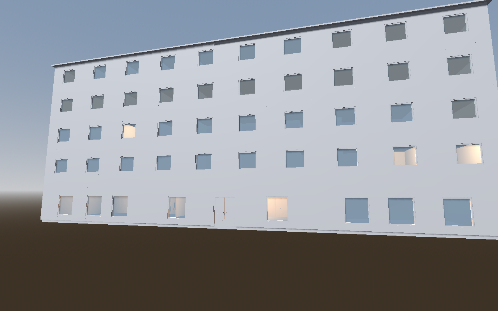

# Meridian Hotel: the elevator test

The fourth AI-authored test building, after [Ravenhold](../ravenhold/README.md), [Kestrel](../kestrel/README.md) and [Halcyon](../halcyon/README.md). It demonstrates **elevators**, new in 1.5.0, in a building where they matter: a five-storey hotel with two passenger lifts and two fire stairs. It was built entirely through CLI recipes generated by one script. What it found, and what was fixed, is in [FINDINGS.md](FINDINGS.md). The hotel is **not** added to the example catalog.



## Layout

North is −Z. The hotel is 40 × 16 m (x −20..20, z −8..8). A 2 m corridor band (z −1..1) runs the full length on every floor.

| Level | Base / walls | Contents |
| --- | --- | --- |
| Ground floor | 0 m / 3.6 m | Lobby behind a double-leaf main entrance, restaurant and lounge through 3 m open passages, kitchen (double service door), restrooms, back office, luggage room. Fire exits from both stair cores. Markers `Reception` and `Arrival`. |
| Floors 2–5 | 3.85, 7.1, 10.35, 13.6 m / 3.0 m | 16 guest rooms per floor, numbered west to east (odd south, even north: 201–219 and 202–212). Each room has an entry door, a 2.0 × 2.2 m bathroom with its own door, and a window. Linen room behind the lifts, ice alcove beside them, corridor end windows. |
| Roof | 16.6 m | Automatic flat roof |

Circulation:

- **Two lifts** (`Lift A`, `Lift B`): 2.6 × 2.4 m shafts side by side in the middle of the north band, at x −1.3 and 1.3. Each has 0.9 × 2.2 m centre-opening doors, on the car and on every landing, facing the corridor (`doorSide: maxZ`). Lift A serves every floor. Lift B runs express past floor 2 (`skipFloorIds: ["l2"]`): its shaft passes floor 2 behind a solid wall, with no landing and no stop. Floors 2–5 get a hole at each shaft, and the ground floor keeps its slab as the pit floor.
- **Two fire stairs**, 5 × 7 m cores at both ends of the north band. Switchback flights alternate between two 1.5 m lanes (22 risers on the ground floor, 19 above), and `stair.guard` rails each opening on the floor above.

`slabsByRoom` is on, so every room and bathroom has its own floor, ceiling and wall-face meshes (`FloorSlab_Room_305`, `InsideFaces_Bath_305`, …) for per-room materials.

Totals: 5 floors, 242 walls, 151 doors, 83 windows, 8 stair flights, 24 guard railings, 2 elevators, 107 lights, 2 markers and 162 regions. That's 771 operations in 4 recipe files.

## Files

| Path | What it is |
| --- | --- |
| `output/meridian_hotel.building.json` | **The editable building.** Load it in the web editor to continue by hand; click a lift on the plan to select, drag or edit it. |
| `output/checks.json` | `validate --warnings-as-errors --reachability --from "0,9"` report |
| `output/navmesh-reachability.json` | Godot navmesh probe (14 targets) |
| `output/lift-probes.json` | Detailed Godot physics probe of both lifts (`qa/validate-elevators.gd`: car at every stop, slab holes, landing and car doors, jambs) |
| `generate-transactions.mjs` | Generates the four recipes from one layout description |
| `tx-1-ground`, `tx-2-guest-low`, `tx-3-guest-high`, `tx-4-circulation` `.edit.json` | Recipes (61, 346, 346 and 18 operations) |
| `views.json`, `probe-targets.json` | Render cameras and navmesh targets |
| `build.sh` | Rebuilds everything from a blank building |
| `godot-renders/` | Curated Godot renders; `renders.json` lists the cameras |

The exported scene isn't committed: a 4.2 MB `.tscn`, 149 door scenes and 2 elevator scenes. `build.sh` regenerates it in a few seconds. From the editor root, pass a new work directory:

```bash
authoring/hotel/build.sh ../hotel-work /path/to/godot
node cli.mjs godot-check --assets ../hotel-work/assets --godot /path/to/godot --render --out ../hotel-work/renders --views authoring/hotel/views.json
```

## How the lifts appear in the export

Each lift is its own scene, `elevators/meridian_hotel_elevator_001_lift_a.tscn`. It is instanced at `Elevators/Elevator_001_Lift_A` in the building scene, at the shaft centre on the ground floor:

```
Elevator (Node3D)            metadata: building_elevator_id, shaft_size, door_width, door_height
├── Shaft, ShaftBody         surfaces ShaftOutside/ShaftInside/ShaftEdges; static collision
├── Car (AnimatableBody3D)   CarMesh (CarFloor/CarWalls/CarCeiling) + collision; move it on Y
│   ├── CarDoorLeft/Right    leaves riding with the car; slide outward on X by Car's leaf_travel
│   └── CarPanel             Marker3D anchor for the car's buttons
├── Stops/Stop_01 …          Marker3D at each stop (metadata/building_floor_id)
└── Landings/Landing_01 …    one per stop (Lift B has none on floor 2):
    ├── DoorLeft/Right       leaves; slide outward on X by the landing's leaf_travel
    ├── CallButton           Marker3D anchor right of the doors, seen from the landing
    └── Indicator            Marker3D anchor above the doors
```

No script is attached. Call buttons, timing, door sequencing and riding the car are the game's: a [game layer](../../GAME_LAYER.md) can attach an `elevator` script on every export. A navmesh cannot ride a lift either. The route check treats the landings as linked, but in Godot the game needs a `NavigationLink3D` (or its own logic) between landings. See the README's **Scope** section.

## Review evidence (AUTHORING_REVIEW §2)

Environment: Linux, Node 22.22.2, Godot 4.5.1 stable. Checks ran headless; renders used Compatibility/OpenGL through Mesa llvmpipe under Xvfb.

| Review item | Status | Evidence |
| --- | --- | --- |
| Schema and authoring validation | Verified | Every recipe passes its dry run and save with `--warnings-as-errors`, as does the final validation (0 errors, 0 warnings) |
| Routes (static check) | Verified | `--reachability --from "0,9"`: every walkable m² is reached on all 5 floors (`output/checks.json`). With the stairs removed, the lifts alone still reach every floor. With the lifts removed, the stairs do. With neither, floors 2–5 are unreachable (0 of about 438 m² each). |
| Lifts in Godot | Verified | `godot-check --assets` probes both lifts (2 elevators, 9 stops, 29 rays, 0 failures): at each stop the moved car carries a floor at the stop height, closed landing doors block the opening, opened landing and car doors lead into the car, and the shaft above the car is clear. The detailed probe (`output/lift-probes.json`, 19 and 16 rays, 0 failures) also checks that floors above the bottom are open at the shaft, the jambs block, and closed car doors block the car when the landing doors are open. |
| Routes (Godot navmesh) | Verified for stairs | 14 of 14 targets from inside the main entrance, including rooms and bathrooms on every guest floor through the fire stairs. The navmesh does not use the lifts (above). |
| Intended floors | Verified | Ground 640 m² automatic slab; upper floors cut at the two shafts and the stair openings. Each room and bathroom has its own `FloorSlab_<Room>`. |
| Lighting shells | Verified in Godot renders | Exterior, lobby, corridor, room, lift-car and stair renders in `godot-renders/` |
| Export | Verified | `godot-check --assets --require-collision`: 152 scenes, 0 failures |
| Express lift | Verified | Lift B has 4 stops and 4 landings (none on floor 2); floor 2 is reached through Lift A and the stairs |
| Character traversal | Partly verified | Connectivity only. Stair comfort (0.175 m risers, 0.23–0.24 m treads), door swing and headroom under the flights are unverified. |
| Materials | Intentionally omitted | Empty by default |

## Known limits of this blockout

- There is no furniture, reception desk or signage: those are props, outside the tool's scope.
- The lift cars are plain boxes with doors; buttons and indicators are only marker anchors (`CallButton`, `Indicator`, `CarPanel`).
- The ground floor's restrooms are one room; a real hotel would split them.
- There is no terrain or plinth; the ground floor sits at y = 0.
